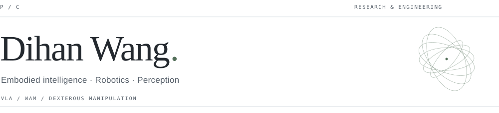
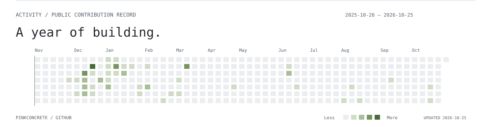

<picture>
  <source media="(prefers-color-scheme: dark)" srcset="./assets/masthead-dark.svg">
  <source media="(prefers-color-scheme: light)" srcset="./assets/masthead-light.svg">
  
</picture>

I work on embodied intelligence, with a current focus on **VLA, WAM, and dexterous manipulation**. My work spans robotics data pipelines, perception tooling, and sensing systems—connecting the data we collect with the actions robots take.

 

## Research & work

**01 / Embodied intelligence**  
Exploring VLA, WAM, and dexterous manipulation, with an interest in how robots connect perception and action in the physical world.

**02 / Robotics data & pipelines**  
Working on data collection, scene annotation, and processing workflows for robotics. Building tools that make experiments repeatable and datasets easier to inspect and reuse.  
[**RoboCOIN — project page ↗**](https://flagopen.github.io/RoboCOIN/)

**03 / Non-contact sensing**  
Developed a millimeter-wave respiratory and heart-rate monitoring system as a graduation project, combining Python signal processing with a Vue/Electron dashboard.

 

## Methods & tools

Python · C++ · ROS · Linux  
OpenCV · PyTorch · Vue · Electron

 

Open-source activity

 
<picture>
  <source media="(prefers-color-scheme: dark)" srcset="./assets/activity.svg">
  <source media="(prefers-color-scheme: light)" srcset="./assets/activity-light.svg">
  
</picture>

 
**DIHAN WANG** &nbsp; / &nbsp; PINKCONCRETE &nbsp; · &nbsp; ROBOTICS &amp; EMBODIED INTELLIGENCE
