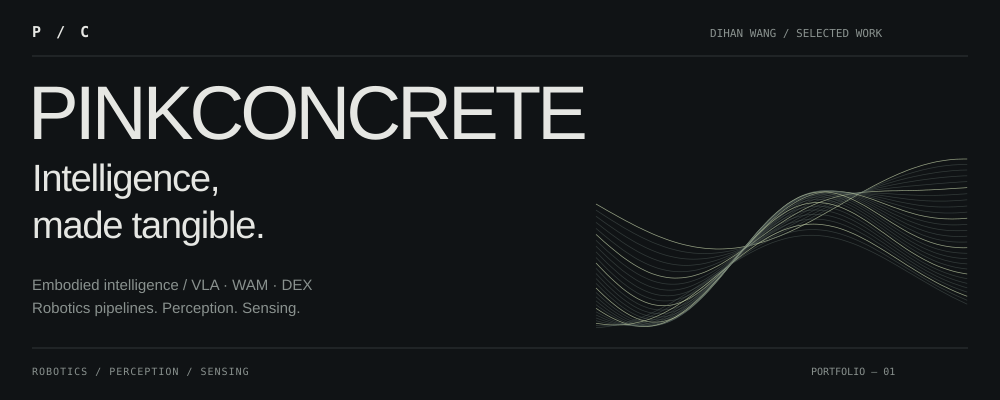
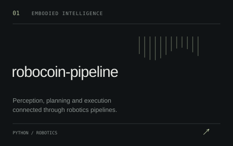
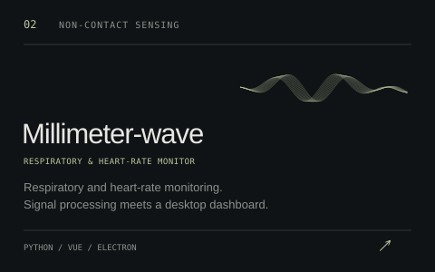
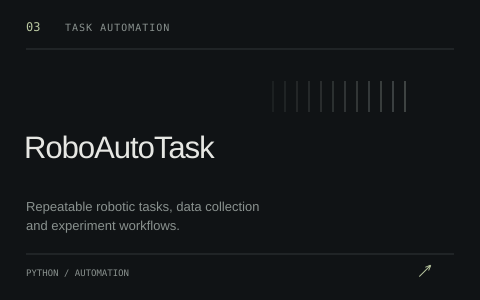
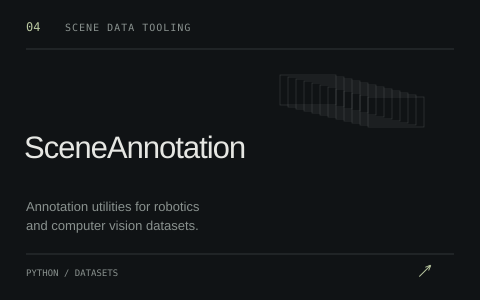
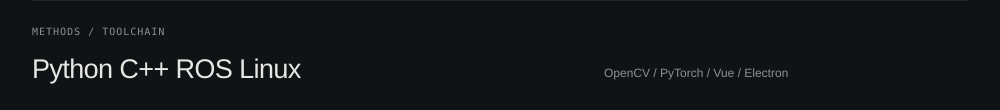
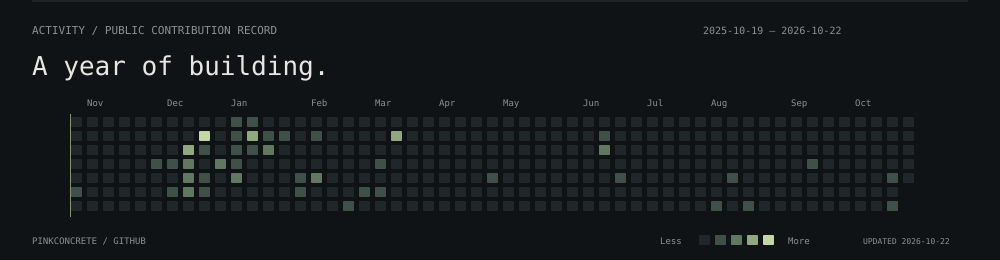

My current focus is embodied intelligence: VLA, WAM, and DEX. I build robotics pipelines, perception tools, and sensing systems.

### Selected research & systems

<table>
<tr>
<td width="50%"></td>
<td width="50%"></td>
</tr>
<tr>
<td width="50%"></td>
<td width="50%"></td>
</tr>
</table>

Project index / text descriptions

- [robocoin-pipeline](https://github.com/PINKCONCRETE/robocoin-pipeline) — Perception, planning and execution connected through robotics pipelines.
- [Millimeter-wave](https://github.com/PINKCONCRETE/Millimeter-wave-Respiratory-and-Heart-Rate-Monitoring-Device) — Respiratory and heart-rate monitoring. Signal processing meets a desktop dashboard.
- [RoboAutoTask](https://github.com/PINKCONCRETE/RoboAutoTask) — Repeatable robotic tasks, data collection and experiment workflows.
- [SceneAnnotation](https://github.com/PINKCONCRETE/SceneAnnotation) — Annotation utilities for robotics and computer vision datasets.

**Current focus** — Embodied intelligence / VLA · WAM · DEX

---
DIHAN WANG / PINKCONCRETE · [All repositories ↗](https://github.com/PINKCONCRETE?tab=repositories)
